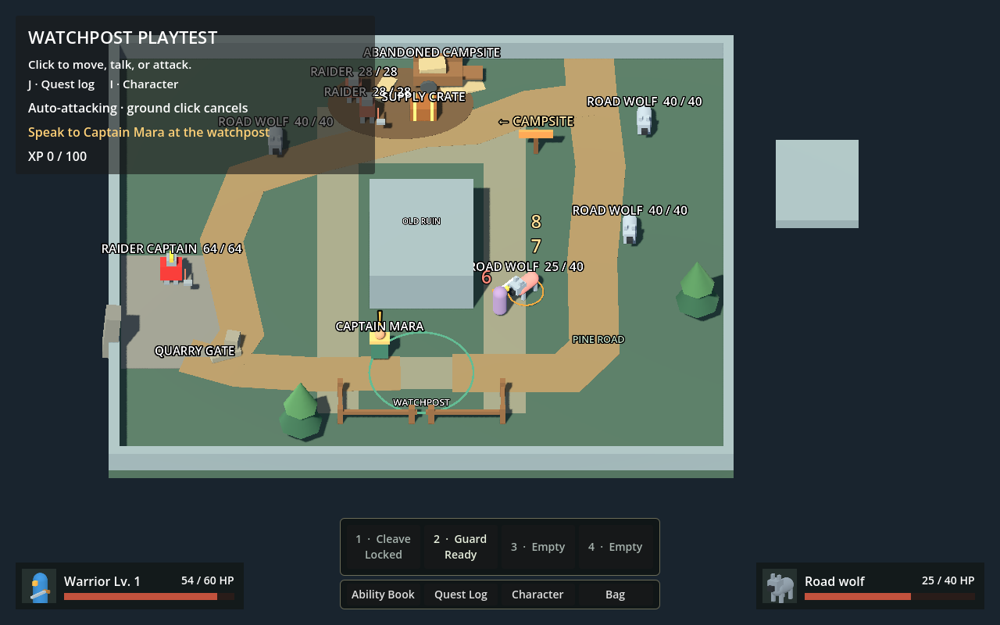
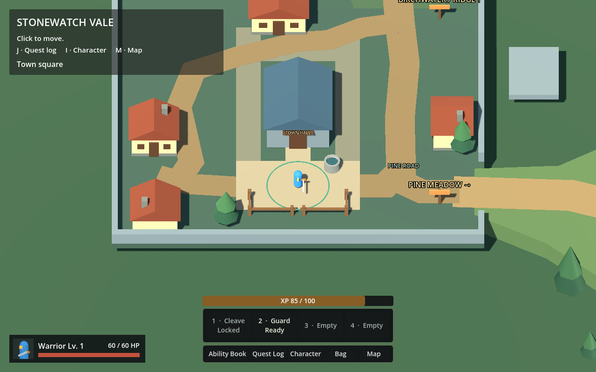
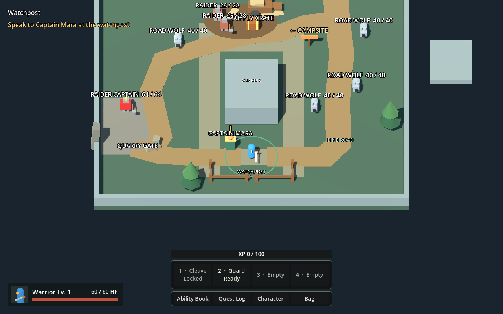
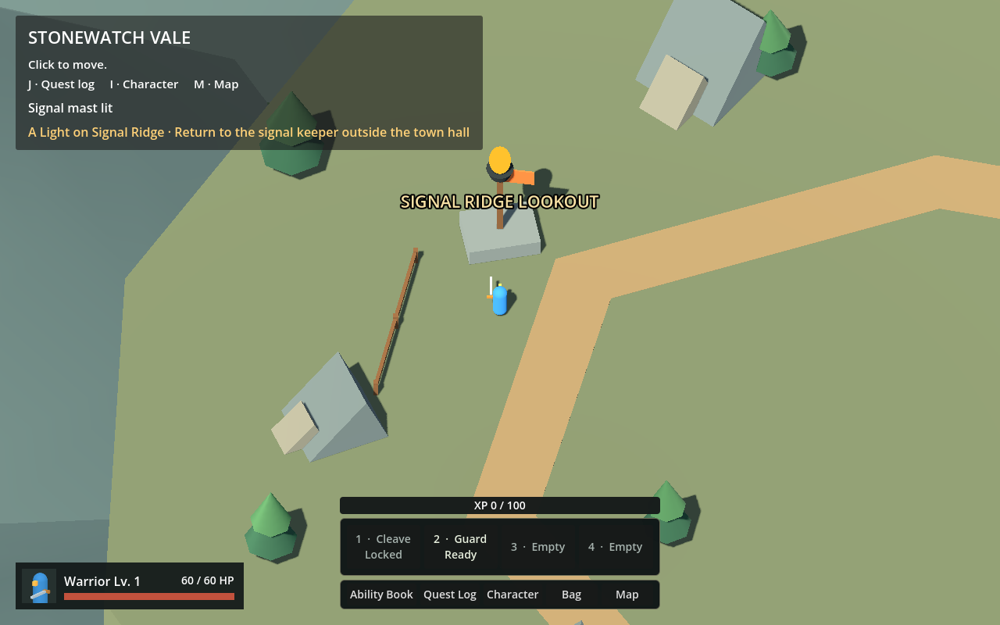
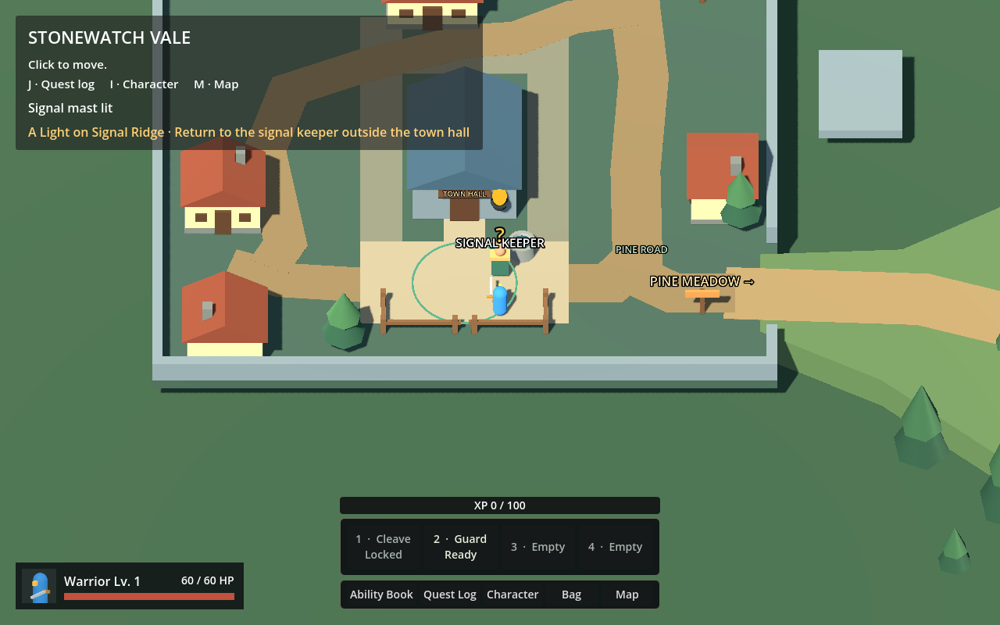

# Stonewatch Vale playtest

## Accepted checkpoints

The user confirmed Windows playtesting for click-to-move and held steering, route breadcrumbs, melee, the full wolf encounter, raiders and Cleave, and the Captain’s telegraph. Prior Windows checks found that fixed HUD panels can overlap world labels as the camera follows the Warrior.

## Automated verification

The original three-quest F5 scene passed the launch smoke test. The terrain navigation bake saved 27 polygons. The four suites passed 156 assertions across movement, combat, the quest chain, and graphical breadcrumbs. The sandboxed editor import completed with a safe-save error during initialization.

## Watchpost Windows playtest

The user completed the watchpost route on Windows. The checks covered navigation and HUD input, all three turn-ins with optional enemies alive, dodging and guarding the Captain’s heavy attack, and progress through defeat and recovery. The route reached 240 XP and level 3. The Iron Sword dealt 12 damage, and the Warden’s Coat granted 2 armor.

## Quest credit and respawn checkpoint

During the previous Break the Blockade playtest, Mara’s offer treated an early Captain defeat as a completed objective. In this checkpoint, kill objectives start at zero and the Captain can return after an early defeat. Regular wolves and raiders return after their configured delay while the Warrior is outside their encounter area. The current placements use a 30-second delay and a 10-meter leash radius. [Issue #1](https://github.com/dylcruz/stonewatch-vale/issues/1), [issue #2](https://github.com/dylcruz/stonewatch-vale/issues/2)

The user reported that wolves killed before quest acceptance stayed defeated. The automated test reproduced this by killing the first road wolf via click-to-attack and waiting at the watchpost, which is inside that wolf’s leash radius. Returning to the green refuge now counts as leaving the encounter for respawns, matching the pursuit rule.

**Automated on Windows with Godot 4.7.2 Standard.** Movement, combat, quest chain, and graphical breadcrumbs passed. The 56 quest assertions include the pre-quest wolf respawn at the refuge, the normal 240 XP route, active-only kill credit, repeated regular defeats, and the Captain’s early defeat and one-time rewards. The quest suite also passed with the Compatibility renderer. The sandboxed runs reported errors writing user data.

**Windows user playtest passed.** The user confirmed the open checks on November 16, 2026.

## Recurring Captain and quest XP checkpoint

The Captain now follows the same exit and timer rules as regular enemies, including after a credited defeat or a completed turn-in. Wolves and raiders award 5 XP per defeat. The Captain awards 15 XP per defeat and the Warden’s Coat on the first defeat. In the watchpost playtest, the three turn-ins award 210 of the 240 XP needed to reach level 3.

**Automated on Windows with Godot 4.7.2 Standard.** Movement, combat, quest chain, and graphical breadcrumbs passed. The quest suite covers XP before acceptance, with the turn-in ready, and after completion, as well as the authored 240 XP route.

**Windows user playtest passed.** The user confirmed the Captain’s return during and after the quest, repeat kill XP, the one-time coat, and the revised quest XP balance.

## Quest journal follow-up

Mara offers Clear Pine Road and Recover the Supplies from the start. The player can accept and turn in either quest first. Break the Blockade unlocks after both turn-ins. [Issue #3](https://github.com/dylcruz/stonewatch-vale/issues/3)

In a fresh Watchpost playtest run, speak to Mara. The opening dialogue shows **Clear Pine Road** and a **View Recover the Supplies** button. Accepting an offer closes the dialogue. Speak to Mara again for the other offer, then open **J** to see both accepted quests.

**Automated on Windows with Godot 4.7.2 Standard.** All five suites passed on the build with the Vale routes and revised XP. The quest suite passed 75 assertions, including both starting offers, independent objectives, both turn-in orders, and HUD tracking. Both offers and the two accepted quests were visible with the Compatibility renderer.

**Windows user playtest passed.**

## Vale routes checkpoint

The terrain now connects the fenced watchpost, Pine Road, the campsite and supply cart, and Quarry Gate. Pine Meadow rejoins North Road at the north meadow junction. Birchwater has a stone ford and timber bridge linked by an east-bank trail. Two climbs connect Signal Ridge and its lookout to North Road. All three loops are open on a fresh run. [Issue #4](https://github.com/dylcruz/stonewatch-vale/issues/4), [issue #5](https://github.com/dylcruz/stonewatch-vale/issues/5), [issue #6](https://github.com/dylcruz/stonewatch-vale/issues/6), [issue #7](https://github.com/dylcruz/stonewatch-vale/issues/7)

The Windows Godot 4.7.2 bake saved 360 navigation polygons. All five regression suites passed. The route suite passed 22 checks with the timed crossing enabled, including two-way portal, river, and ridge movement, matching placements across fresh runs, and command preservation when clicking deep water or a cliff. The route and landmark views were checked with the Compatibility renderer.

### Recorded timings

Times are 60 Hz simulation time from scripted gameplay clicks on Windows. The watchpost run started from a fresh instance and included combat and turn-ins with zero recoveries. The crossing used camera clicks and walked each leg from Heather Rest onward.

| Route | Measured time |
| --- | ---: |
| Watchpost → three road wolves → Mara | 21.7 s |
| Watchpost run through the supply crate turn-in | 33.4 s cumulative |
| Watchpost run through the Captain turn-in, optional encounters alive | 42.1 s cumulative |
| Heather Rest → north meadow junction → North Road → south ridge climb → Signal Ridge lookout, 613.9 m | 124.6 s |

The scripted watchpost run is below the 10–15 minute benchmark. The three existing quest placements are close to Mara. Further pacing work can use the measured runs as a baseline. [Issue #8](https://github.com/dylcruz/stonewatch-vale/issues/8)

To rerun the automated crossing, append `-- --pace` to the `vale_routes_test.gd` command.

### Windows user playtest

The user confirmed all Vale routes playtest items were complete on November 16, 2026. The playtest identified follow-up work for scenery collision and the view beyond walkable terrain. [Issue #20](https://github.com/dylcruz/stonewatch-vale/issues/20), [issue #21](https://github.com/dylcruz/stonewatch-vale/issues/21)

## Starting town checkpoint

A fresh game starts in the town square on the old Watchpost site. The town hall, cottages, and well are graybox placeholders. Two cottages occupy the former campsite and Quarry Gate sites. Pine Road leads east to Pine Meadow. The separate Watchpost developer scene contains the original landmarks, Captain Mara, the wolves and raiders, and the three quests. [Issue #27](https://github.com/dylcruz/stonewatch-vale/issues/27)

**Automated on Windows with Godot 4.7.2 Standard.** Both navigation bakes and all five regression suites passed. The route suite walked around the new cottages and out to Pine Meadow, opened the empty journal and gear panel, and verified town square recovery. The separate Watchpost scene retained both landmarks and passed all 75 quest checks.

**Windows user playtest passed.** The user confirmed the starting town checkpoint on November 16, 2026.

## Compact Watchpost developer scene

The Watchpost developer scene now ends at the arena walls. It keeps the original encounters, campsite, Quarry Gate, and the three quests. The main game loads the larger Vale routes.

**Automated on Windows with Godot 4.7.2 Standard.** Both bakes and all five regression suites passed. The Watchpost bake has 40 polygons, and all 75 quest checks passed. The route suite verified the two closed exits and completed the timed crossing in the main game with the same baked mesh.

- [ ] Open `scenes/watchpost_playtest.tscn` and press **F6**. Walk to the east and north walls, then return to Captain Mara in the square. Press **F5** after stopping the playtest to verify that Pine Meadow and North Road are open from town.

## Save checkpoint

**Automated on Windows with Godot 4.7.2 Standard.** All six regression suites passed. The save suite launched seven separate Godot processes and checked town recovery, unreadable-slot handling, a mid-quest relaunch, both Captain defeat paths, and equipment and progress after the final turn-in.

- [ ] Press **F5**, start **New Game**, stop the game, and select **Continue** after relaunching. Verify the Warrior starts in the town square.
- [ ] Run `godot --path . -- --watchpost-save`, accept a quest, advance the objective, and relaunch. Verify Continue returns to the refuge with the same journal progress and equipped gear.

## Vale scenery and collision

Pine trunks, outcrops, and the two Birchwater bridge rails have obstacle collision. Lower woodland fills the view beyond Pine Meadow and North Road. Birchwater continues into the woods, and stone peaks frame the Signal Ridge cliffs. [Issue #20](https://github.com/dylcruz/stonewatch-vale/issues/20), [issue #21](https://github.com/dylcruz/stonewatch-vale/issues/21)

**Automated on Windows with Godot 4.7.2 Standard.** The Watchpost and town bakes saved 52 and 1,880 polygons respectively. The route suite verifies both bridge directions, walking around a trunk and an outcrop, physical collision at both rails, and command preservation when clicking solid objects or scenic boundaries. The Compatibility renderer was used to inspect North Road, Heather Rest, the timber bridge, and the Signal Ridge lookout.

- [ ] Walk across the timber bridge both ways and click each rail while moving down the deck.
- [ ] At Heather Rest and Signal Ridge, check the woodland and peaks from the trail. Click beyond the edge while moving and verify the original destination remains active.

## Character and inventory

**I** opens the character panel. Equipped weapon, armor, and bag appear above the stored items. The Trail Pack holds six items and the Scout Pouch holds two. A bag change that would overflow is refused. Rewards wait for a free slot and can be claimed from the panel. [Issue #22](https://github.com/dylcruz/stonewatch-vale/issues/22), [issue #23](https://github.com/dylcruz/stonewatch-vale/issues/23)

**Automated on Windows with Godot 4.7.2 Standard.** The character and inventory suite passed 15 checks, including live health and level updates, both gear upgrades, full-bag feedback, waiting rewards, and safe bag changes.

- [ ] In the Watchpost developer scene, open the bag and equip the Scout Pouch. Earn the Iron Sword and the Warden’s Coat. One reward should wait until you equip the Trail Pack and claim it. Attempt to equip the Scout Pouch again while storing three items.

## World map

Press **M** in the main Vale to see the route cells you have entered. Landmarks appear when their area is explored. A fresh run starts with only the town square area revealed. Exploration stays visible while traveling elsewhere in the same run. [Issue #24](https://github.com/dylcruz/stonewatch-vale/issues/24)

**Automated on Windows with Godot 4.7.2 Standard.** All six suites passed. The map suite passed 16 checks covering concealed terrain, different orders, walking into a new area, revisits, and HUD input. The fresh and partially explored views were checked with the Compatibility renderer.

- [ ] Open the map in town, then walk to Heather Rest or Birchwater first. Verify only the traveled area and discovered landmarks are shown. Leave and reopen the map to check that the first area remains visible.

## Windows release verification baseline

The baseline was `6a92fe4bd4cf83bfe640da64eea57b7cdc8238c7` on Windows with Godot Standard `4.7.2.stable.official.ed1daf0bf` and the Compatibility renderer. [Issue #13](https://github.com/dylcruz/stonewatch-vale/issues/13), [issue #15](https://github.com/dylcruz/stonewatch-vale/issues/15)

| Check | Observed result |
| --- | --- |
| Five existing regression suites | Passed on Windows. |
| Fresh Watchpost route with graphics | 75 automated checks passed. All three turn-ins succeeded with the optional enemies alive. |
| Sword, coat, and level | The Iron Sword dealt 12 damage, the coat added 2 armor, and the required route reached level 3 at 240 XP. |
| Captain heavy attack | Moving clear avoided the hit. Guard halved it to 10 damage. |
| Windows x86_64 baseline export | Built from a clean copy of the baseline with the official 4.7.2 release template. The staged preset pointed at the downloaded template and declared an empty include filter. |
| Clean-directory graphical launch | `builds/windows-verification-6a92fe4/clean/StonewatchVale.exe` started with Compatibility and exited successfully after 120 frames. Its directory contained only the executable. |

The SHA-256 of the local baseline executable is `87ce05891eaf579dee44d41820989a075a9d8f8d3854a7d60bac6f3808717957`. The sandbox reported user-data and shader-cache write errors during the local smoke tests.

See [the release review notes](review-issues-13-15.md) for the final candidate checklist.

## Integrated issue branches

**Automated on Windows with Godot 4.7.2 Standard.** All eight regression suites passed. The relaunch suite verifies the equipped bag, stored gear, and unclaimed rewards through Continue, including a checkpoint from before bags were introduced.

The route suite passed 55 checks with `--pace` enabled. It walked from the town entrance to Heather Rest, then measured 623.1 meters and 127.3 seconds of simulation time from Heather Rest to Signal Ridge via North Road. The scripted clicks use the open trail around two newly solid meadow pines.

## Ability book and bar

Open the ability book with **K** or from the menu row below the ability bar. Click a bar slot to select it, then assign an unlocked ability or clear the slot. Close the book to activate abilities with a bar click. Shortcuts **1–4** follow the slot arrangement. The menu row also opens the quest log, character sheet, bag, and main Vale map. [Issue #30](https://github.com/dylcruz/stonewatch-vale/issues/30), [issue #38](https://github.com/dylcruz/stonewatch-vale/issues/38)

**Automated on Windows with Godot 4.7.2 Standard.** The ability UI suite checks keyboard and mouse input, menu switching, locked Cleave, Guard activation after a swap, clearing and restoring slots, and movement command preservation. Guard and Cleave cooldowns are exercised by the combat suite. The bars and book were inspected with the Compatibility renderer.

- [ ] Open the Watchpost developer scene with **F6**. Press **K**, select slot **3**, and assign Guard. Close the book and press **3** during a wolf bite windup. Verify the Guard ring and cooldown.
- [ ] Reach level 2 and verify Cleave becomes assignable with the book open. Swap or clear slots, then try the updated shortcuts.
- [ ] Use **F5** and change the layout in a saved town run. Relaunch with **Continue** and verify the layout is restored.

## Roadmap milestone 1 · Verify the menus on dev

Run `godot --path . -- --watchpost-save` in a Windows debug build, then select **New Game** in the Watchpost Playtest menu. This entry point uses the developer save slot and lets the same run resume through **Continue**. The route starts from `e1818a8` on `dev`. [Roadmap issue #49](https://github.com/dylcruz/stonewatch-vale/issues/49)

| Menu | Playtest route | Windows observations |
| --- | --- | --- |
| [Quest Log (#31)](https://github.com/dylcruz/stonewatch-vale/issues/31) | Accept Clear Pine Road and Recover the Supplies from Mara. Track Recover the Supplies while walking and check the HUD and destination. Defeat three road wolves and turn in Clear Pine Road before collecting the crate. | Both quests appeared in the log. Tracking Recover the Supplies updated the HUD. Clear Pine Road showed Ready to turn in, then Completed, while Recover the Supplies stayed In progress and Tracked. The quest suite checked that tracking preserves a movement command. |
| [Ability Book (#30)](https://github.com/dylcruz/stonewatch-vale/issues/30) | Open the book before fighting. Check the effects, cooldowns, and availability of Guard and Cleave. Activate Guard from the bar. After the wolf turn-in, reopen the book and assign Cleave. | The level 1 book showed Guard available and Cleave locked. Guard activated from the bar and displayed its ring and cooldown. The bar showed Cleave ready at level 2. The ability UI suite verified the book's assignment control unlocks while the book is open. |
| [Bag (#32)](https://github.com/dylcruz/stonewatch-vale/issues/32) | Equip Scout Pouch before the road quest turn-in and equip the earned Iron Sword. Defeat the Raider Captain at Quarry Gate while the pouch holds the Training Sword and Trail Pack. Try to claim the waiting Warden's Coat with the full pouch. Equip Trail Pack, claim and equip the coat, then try switching back to Scout Pouch. Close the game and relaunch with **Continue**. | The live run confirmed the starter pack swap. The relaunch suite drove the Bag controls and verified the restored full pouch, failed claim feedback, the successful swap and claim, the restored Trail Pack with three used slots, and the rejected swap back to the undersized pouch. |
| [Character (#36)](https://github.com/dylcruz/stonewatch-vale/issues/36) | Leave Character open for the first wolf fight. Check level, XP, and maximum health after the road turn-in. Equip the sword and coat through Bag, then reopen Character and verify their names, sword damage 12, and armor 2. | The open sheet updated from 60/60 to 42/60 health and from 0 to 5 XP during the first fight. The road turn-in raised the Warrior to level 2 at 100 XP with 75 maximum health. Automated checks verified the updated sheet at level-up and after changing equipment and resuming through Continue. |

The interactive run used Godot Standard 4.7.2 and the Compatibility renderer with an isolated developer save. Mouse controls were used for the observed results. The regression suites exercised the keyboard shortcuts through Godot input events. The live run ended after the road turn-in, so a player should finish the bag, gear, and Continue steps in the same Windows playtest and confirm the shortcuts on a physical keyboard before proceeding to Birchwater.

## Birchwater delivery checkpoint

**First-time Windows playtest.** From the main menu choose **New Game**. Ask the player to leave town, find an adventure, and finish it. Let them choose the route without showing them the screenshot or the tester notes below. After turn-in, relaunch and select **Continue**.

| Record during the session | First-time player observation |
| --- | --- |
| New Game to discovering the offer | The player went east first and wandered without finding an activity or a reason to head north. Time unreported. Revisit this when adding quests in the starting town. |
| Time reading the offer and clues, whether the player noticed the cloth, and where they hesitated | The playtester flagged the red cloth on the old bridge rail beside the bundle. The revised offer points to a matching swatch on the ferryman’s cart at the ford. Reading time and first sighting unreported. |
| Route chosen and time spent in combat | Pending |
| Return and turn-in time, total adventure time, and what changed at the cart after Continue | Pending |
| Full-zone crossing time on foot and route taken | Pending |

**Tester notes.** The ferryman at Birchwater Ford offers the delivery. The player can cross the ford, follow the east bank to the timber bridge, and collect the bundle with the west-bank wolf alive. The shorter west-bank approach passes the wolf. Turn-in awards 85 XP once and loads the cart.

The Windows Godot 4.7.2 route regression walked from the town square through the quiet-bank delivery in 95.8 seconds of simulation. Heather Rest to Signal Ridge via North Road covered 623.1 meters in 127.3 seconds. The scripted run reads and accepts dialogue immediately. Compare first-time observations with the 10–15 minute adventure benchmark before tuning the clues or distances. [Birchwater delivery](https://github.com/dylcruz/stonewatch-vale/issues/44) · [Travel pacing](https://github.com/dylcruz/stonewatch-vale/issues/8)

## Continue after an item’s reward source moves

The Windows save regression earns the Iron Sword and a waiting Warden’s Coat in the Watchpost, then opens that temporary checkpoint in town through Continue. Town has neither reward source. The restored sword deals 12 damage and the Scout Pouch is full. Switching to the Trail Pack makes room to claim and equip the coat. A second relaunch restores 2 armor, three free slots, and an empty waiting-reward list. The suite also loads a checkpoint from before bags were introduced. [Issue #47](https://github.com/dylcruz/stonewatch-vale/issues/47)

When authoring an item that can be saved, register its resource under its permanent item ID in `scripts/item_catalog.gd`. Keep that entry when retiring its original quest or encounter.

## Vale map discovery through Continue

Press **M** while following North Road to Birchwater. Explored cells show woodland, trails, the river, and its crossings. Each new cell triggers a checkpoint. The Windows relaunch suite walks into Heather Rest without advancing a quest or changing equipment, quits, then checks that Continue reveals Heather Rest and keeps Signal Ridge concealed. It also checks that an older save opens in town and New Game resets discovery. [Issue #35](https://github.com/dylcruz/stonewatch-vale/issues/35)

For the hands-on check, visit the ford and one bank, relaunch with **Continue**, and compare the map with the route walked. The player marker should return to town while the explored route stays visible.

## Combat portraits and selected-target health

The Warrior’s portrait and health sit in the lower left. Selecting a living enemy shows its portrait and health in the lower right. The Captain’s ground telegraph warns of an incoming heavy attack even after deselection. The current actors use health as their only resource. Portraits are rendered from their in-game models. [Issue #39](https://github.com/dylcruz/stonewatch-vale/issues/39)

The Windows combat suite checked an empty target frame at spawn, switching from a wolf to the Raider Captain, damage to both actors, ground deselection, target death, and player recovery. It also checked the Captain’s heavy-attack warning with no target selected.

For hands-on verification, approach the Birchwater wolf, select it, then click the ground during pursuit. The target row should disappear while the Warrior’s health stays visible. In the developer Watchpost, repeat with the Captain during a heavy windup and check that the warning stays visible.

## Scrolling combat damage

Hits show the health lost above the struck actor. Incoming damage appears in coral and damage to enemies appears in gold. Each number rises and fades while following the model. [Issue #55](https://github.com/dylcruz/stonewatch-vale/issues/55)

All nine Windows regression suites passed. The combat suite checked a guarded bite, both targets of Cleave, zero damage, upward movement, and expiry. The scripted capture includes an extra hit on the wolf to show how consecutive numbers stack.

For hands-on verification, fight a road wolf and use Guard as it bites. Compare the coral number with the change in the Warrior’s health. Click through a rising number to move, then try Cleave against both camp raiders at level 2.

## Out-of-combat health recovery

For the Windows playtest, take a bite from the Birchwater wolf, click the ground to flee, and watch the Warrior’s health. It should hold steady during pursuit and rise by 2 HP per second once the wolf turns home. Approach again before reaching full health. Recovery should stop as soon as pursuit resumes, before the next bite.

The user confirmed the Windows playtest passed at 2 HP per second. All nine Windows regression suites also passed. The combat suite verified recovery after two escapes, interruption by an unselected wolf, the maximum-health cap in the HUD, and defeat and respawn. [Issue #42](https://github.com/dylcruz/stonewatch-vale/issues/42)

## XP progress above the ability bar

For the Windows playtest, turn in the Birchwater delivery and check the gold bar above the abilities. A fresh Warrior who skipped the wolf should see **XP 85 / 100**. Relaunch and choose **Continue** to check the same fill in town. A Warrior who reaches level 2 at exactly 100 XP sees **XP 0 / 140**. Any excess XP counts toward those 140 points. At level 3 the bar stays full and reads **Max level**.

All nine Windows regression suites passed. The route suite checked the turn-in and Continue. The inventory and quest suites checked the level-up and cap. A scripted Windows capture shows the bar at 85 XP. The user accepted the revised per-level XP display. [Issue #40](https://github.com/dylcruz/stonewatch-vale/issues/40)

## Watchpost feedback

Open `scenes/watchpost_playtest.tscn` and press **F6**. Speak to Captain Mara, accept Clear Pine Road, and defeat a road wolf. The gold objective should update over the terrain. Status and loot messages use the same corner, and clicks through the text reach the world.

All nine Windows suites passed. The movement suite checked that a press over the objective reaches the world and that pressing the XP bar still consumes input. The quest and combat suites exercised tracked objectives, loot notices, health frames, and the Captain’s attack warning. The user completed the Windows playtest and approved the merge. [Issue #41](https://github.com/dylcruz/stonewatch-vale/issues/41)

## A Light on Signal Ridge

For the first Windows run, leave town without speaking to the signal keeper. Take either signed climb from North Road and click the mast at the lookout. Check the journal, then return to town and look beside the hall doors. Speak to the keeper and claim the 70 XP. Relaunch and choose **Continue** to revisit the lantern and the keeper. For the other discovery order, speak to the keeper first on a fresh run and take the other climb.

The timed Windows route suite passed 98 checks. It tested both discovery orders, both climb connections, a single ready journal entry, and Continue before and after turn-in. During hands-on playtesting, the player found that the ridge quest naturally led them to the ferryman. The following captures show the mast after lighting and the answering lantern before turn-in. [Issue #45](https://github.com/dylcruz/stonewatch-vale/issues/45)

## Birchwater current and Signal Ridge bell

Start a run with an unlit mast. Walk from North Road toward the ford, cross the river, then visit the timber bridge. Listen for the current getting louder near the water and fading on the road. Light the Signal Ridge mast, let the bell decay, and relaunch with **Continue**. Returning to the mast should be quiet.

A Windows gameplay run sampled the master audio output at both crossings, on the bank, in town and at the mast. The river was louder at each crossing than on the bank, and the bell decayed to silence. The route suite verified silent restores before and after turn-in for both discovery orders. Hands-on listening is pending. [Issue #46](https://github.com/dylcruz/stonewatch-vale/issues/46)
